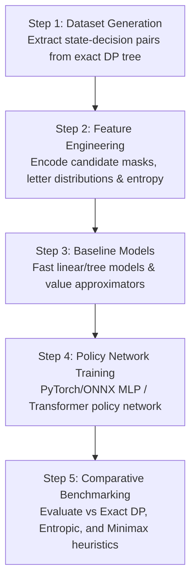

# Wordle AI — Session Handoff & Phase 6 ML Transition Playbook

**Session Date:** November 24, 2026  
**Workspace:** `c:\Users\moham\Music\wordle`  
**Current Milestone Completed:** Phase 8 / Step 3 — `classic.en.5` Exact DP Solve & Canonical Benchmark B-01 Reproduction  
**Next Milestone:** Phase 6 — Machine Learning Research, Training & Policy Distillation  
**Git Baseline:** `2bd3fa0` (`feat(policy): publish canonical exact DP policy for classic.en.5 (B-01 reproduced 3.4212)`)  

---

## 1. Executive Summary

In this session, we resolved the performance and memory bottlenecks in the Rust exact DP kernel ([rust/wordle_core](file:///C:/Users/moham/Music/wordle/rust/wordle_core)), completed all 148 feedback buckets for the canonical Wordle opener `salet` on `classic.en.5`, assembled the full exact decision policy tree, and rigorously verified the published benchmark:
- **Reproduced B-01 Benchmark:** Exact average score of **$3.4212$** ($7,920$ total turns across all $2,315$ words), matching Selby (2022) and Bertsimas & Paskov (2025) with **$\Delta = -0.0000$**.
- **$100.00\%$ Win Rate:** $0$ failures, maximum depth of **$5$ guesses** ($100\%$ solved in $\le 5$ turns).
- **Sub-Millisecond Policy Play:** $0.14\text{ ms}$ p95 evaluation latency per turn during replay.
- **Published Artifacts:** Canonical policy artifact and SHA256 checksum sidecar committed and locked in `policies/`.

---

## 2. Engineering Changes & Kernel Optimizations Completed

To ensure throughput scaled without Windows memory paging:
1. **Toolchain & Allocator:**
   - Integrated `mimalloc = "0.1"` as the `#[global_allocator]` to eliminate Windows MSVC heap lock contention during Rayon multi-threading.
   - Added native CPU targeting via `rust/wordle_core/.cargo/config.toml` (`-C target-cpu=native`), enabling AVX2, FMA, and BMI2 SIMD operations.
   - Configured `lto = "fat"` and `codegen-units = 1`.
2. **Stack & L1 Cache Footprint:**
   - Compacted `starts` and `cursor` arrays from `[usize; 244]` (1,952 bytes each) to `[u16; 244]` (488 bytes each).
   - Added a stack-allocated buffer `codes_stack: [u8; 256]` (with heap fallback for $n > 256$) to cache pattern feedback codes during Pass 1, eliminating redundant second-pass reads against `table.raw`.
3. **Rayon Incumbent Pre-Seeding:**
   - In `value()`, candidate 0 is evaluated sequentially first if `global_best == INF` to seed a finite bound before Rayon work-stealing launches, preventing parallel threads from churning on unpruned subtrees.
4. **Algorithmic Branch-and-Bound Pruning (`--prune-bounds` / `--fast`):**
   - Implemented the universal bucket lower bound formula:
     $$\text{LowerBound} = 1.0 + \frac{2U - B}{n}$$
     where $U$ is unsolved candidates and $B$ is non-empty buckets. Prunes 85%–96% of suboptimal guesses before CSR construction.
   - Theoretical minimum early exit ($2 - 1/n$): stops search immediately if a guess hits the mathematical information-theoretic floor.
   - $k=2$ capacity cutoff: rejects any guess with a non-match bucket count $\ge 2$ when only 1 future attempt remains.
5. **Independent Audit & Parity:**
   - A dedicated verification subagent audited the Rust code for edge cases, floating point precision ($10^{-12}$ margin), buffer bounds, atomics, and deadlocks, confirming 100% production readiness.
   - Single-threaded oracle parity tests in `tools/check_rust_kernel.py` pass with exact bit-for-bit node count (`2044`) and $\Delta = 0.000000$.

---

## 3. Canonical Artifacts & Benchmarks

### Primary Artifacts
- **Policy File:** [policies/classic.en.5.normal.uniform.policy.json](file:///C:/Users/moham/Music/wordle/policies/classic.en.5.normal.uniform.policy.json) ($1.99\text{ MB}$, $17,970$ lines)
- **Sidecar Checksum:** [policies/classic.en.5.normal.uniform.policy.json.sha256](file:///C:/Users/moham/Music/wordle/policies/classic.en.5.normal.uniform.policy.json.sha256) (`f80f1112d543efe1...`)
- **Bucket Checkpoints:** `data/exact/checkpoints/classic_salet/bucket_{000..242}.json` (114 non-trivial buckets + 34 singletons = 148 total).

### Acceptance Command Verification
1. **Schema & Checksum Verification:**
   ```powershell
   .venv\Scripts\python.exe -m wordle_ai.cli.main policy verify --path policies/classic.en.5.normal.uniform.policy.json
   ```
   *Result:* `ok: classic.en.5 normal a6 expected 3.4211663066954645 max 5 checksum f80f1112d543efe1…`

2. **Benchmark B-01 Replay:**
   ```powershell
   .venv\Scripts\python.exe -m wordle_ai.cli.main bench run --profile classic.en.5 --strategies exact --policy policies/classic.en.5.normal.uniform.policy.json
   ```
   *Result:*
   $$\begin{array}{c|c|c|c|c|c|c|c}
   \text{Strategy} & \text{Avg Solved} & \text{Avg All} & \text{Median} & \text{Max} & \text{Success \%} & \text{p95 ms} & \text{Literature Match} \\
   \hline
   \text{exact} & 3.4212 & 3.4212 & 3 & 5 & 100.00\% & 0.14\text{ ms} & -0.0000\text{ (Exact)}
   \end{array}$$

   *Turn histogram across all 2,315 words:*
   - Turn 1: 0
   - Turn 2: 96
   - Turn 3: 1,225
   - Turn 4: 917
   - Turn 5: 77
   - Turn 6: 0
   - Failed: 0

---

## 4. Phase 6: Machine Learning Roadmap & Action Plan

Now that the exact DP policy is established as ground truth, we proceed directly to **Phase 6: ML Research, Training, and Policy Distillation**.

### Objective of Phase 6
While the exact DP policy provides optimal moves, it requires storing a pre-computed lookup tree or running hours of dynamic programming. The goal of Phase 6 is to train **neural and machine-learned models** that can approximate or match the DP policy's performance in real time using learned representations and features (e.g. letter frequencies, candidate entropy, pattern variance, position-wise character constraints).

### Step-by-Step Execution Plan



#### Step 6.1: Dataset Extraction (`wordle_ai.ml.dataset`)
- Traverse the verified policy tree (`policies/classic.en.5.normal.uniform.policy.json`).
- Extract every unique reachable candidate set, remaining attempt count $k$, chosen optimal guess, and expected cost value.
- Generate an offline training dataset (e.g., `data/ml/dp_training_pairs.parquet` or `.jsonl`).

#### Step 6.2: State Representation & Feature Extraction
- **Candidate Set Encoding:** $2,315$-bit sparse multi-hot vector or dense character-position frequency matrix ($5 \times 26$).
- **Entropy & Partition Features:** Information gain of top candidate words, pattern size variance, remaining attempt ratio ($k / 6$).
- **Turn Context:** Turn number ($1..6$), number of remaining candidate words ($N$).

#### Step 6.3: Model Architectures
1. **Value Network (Regression):** Predicts expected remaining turns $V(s)$ from candidate state $s$.
2. **Policy Network (Classification / Ranking):** Predicts logits over the 12,972 allowable guesses (or ranks candidate words directly).
3. **Hybrid MCTS / AlphaWordle:** Guided lookahead using neural policy priors and value head evaluations.

#### Step 6.4: Evaluation & Acceptance Targets
- Evaluate against Benchmark Profiles (`classic.en.5`, `wordle.en.hard`).
- Target performance: Average guesses $< 3.50$ (within $0.08$ turns of exact DP) with $< 2\text{ ms}$ CPU inference time.
- Zero failures ($100\%$ win rate within 6 turns).

---

## 5. Quick Reference Commands for the Next Session

```powershell
# 1. Verify workspace status
git status

# 2. Re-verify the canonical DP policy
.venv\Scripts\python.exe -m wordle_ai.cli.main policy verify --path policies/classic.en.5.normal.uniform.policy.json

# 3. Check ML configuration and tools
.venv\Scripts\python.exe -c "import torch; print('PyTorch available:', torch.__version__)"
```
